  

  # 🎨 Awesome Generative AI Media APIs 🚀

  

    <strong>A curated directory of premier Generative AI Media APIs, Serverless Inference Gateways, OpenAI-Compatible Endpoints &amp; Self-Hosted Multi-Modal Orchestration Frameworks.</strong>
  

  

    
    
    
    
    
    
  

---

## 📖 Overview & Architectural Landscape

In contemporary artificial intelligence engineering, the generative media frontier has transitioned from exploratory notebook prototypes to production-grade, latency-critical HTTP/WebSocket application programming interfaces (APIs). **Generative AI Media APIs** encapsulate state-of-the-art diffusion transformers, flow-matching architectures, voice synthesis models, and video latent generators behind standardized interfaces.

These tools expose high-throughput image generation (`/v1/images/generations`), speech synthesis (`/v1/audio/speech`), voice cloning, and text-to-video rendering through two distinct paradigms:
1. **Managed Serverless Cloud Gateways**: Commercial inference brokers (such as Fal.ai, Replicate, Stability AI, and OpenAI) that eliminate GPU infrastructure overhead with per-second or per-output billing, instant cold starts, and autoscaling model catalogs.
2. **Self-Hosted & OpenAI-Compatible Private Gateways**: Open-source servers (such as ComfyUI, LocalAI, inferhost, Kokoro-FastAPI, and Diffusers) that transform dedicated bare-metal GPUs into private, sovereign media endpoints offering granular node-graph workflow execution, multi-model hot-swapping, zero API egress costs, and complete data privacy.

---

## 📑 Table of Contents

- [🌐 Sector Overview & Market Dynamics](#-sector-overview--market-dynamics)
- [☁️ SaaS & Hosted Platforms](#️-saas--hosted-platforms)
- [🔓 Open-Source GitHub Projects (Ranked by Stars)](#-open-source-github-projects-ranked-by-stars)
- [📊 Architectural Comparison Matrix](#-architectural-comparison-matrix)
- [🤝 How to Contribute](#-how-to-contribute)
- [💖 Support](#-support)
- [📈 Saar History](#--saar-history)
- [⚖️ Disclaimer](#️-disclaimer)

---

## 🌐 Sector Overview & Market Dynamics

The global **Generative AI Media & Content Generation API market** is estimated at **$2.4 Billion in 2024** and is projected to expand to **$18.6 Billion by 2032**, demonstrating an aggressive compound annual growth rate (**CAGR of ~32.4%**). 

From a competitive landscape perspective, the sector is currently **moderately fragmented and rapidly bifurcating** rather than operating under a winner-take-all dynamic:
- **Barbell Market Structure**: At one end, foundation model hyperscalers (e.g., OpenAI, Black Forest Labs, Runway) preserve pricing power on proprietary flagship weights and frontier visual fidelity. At the other end, the rapid release of high-performance open weights (e.g., FLUX.1 [dev/schnell], SD 3.5, Kokoro, CogVideo) has spawned a fiercely competitive tier of serverless brokers (Fal.ai, Replicate) and self-hosted runtimes (ComfyUI, LocalAI).
- **Interoperability & Protocol Standardization**: The emergence of the **OpenAI-compatible schema** for images (`/v1/images/*`) and audio (`/v1/audio/*`) acts as an anti-lock-in force, enabling engineering teams to dynamically route workloads across cloud APIs and on-premises inference clusters based on real-time latency and spot-instance GPU economics.

---

## ☁️ SaaS & Hosted Platforms

The table below outlines leading enterprise hosted and cloud-native SaaS generative media API platforms, comparing company scale, specific starting tier pricing, explicit free tier / free trial limits, and architectural delivery focus. The platforms are sorted in **descending order by company scale (valuation / revenue)**.

| Platform | Company & Scale (Valuation / Revenue) | Starting Tier Price | Free Tier Limit / Free Trial Limits | Key Capabilities & Architecture Focus |
| :--- | :--- | :--- | :--- | :--- |
| **[OpenAI Images API](https://platform.openai.com/docs/guides/images)** | **OpenAI, Inc.** 📊 Valuation: ~$157B (Oct 2024 Round) 💰 Revenue: ~$3.7B - $4.0B ARR | **$0.020 / image** for DALL·E 2 (1024×1024 or 512×512); **$0.040 / image** for standard DALL·E 3 (1024×1024); **$0.080 / image** for HD DALL·E 3; pay-as-you-go with a minimum **$5.00** prepaid credit deposit. | **Free-forever web access** includes 2 free DALL·E 3 generations per day in ChatGPT free tier; API developer accounts receive a **90-day trial window** with tier-based quota access upon registering an initial payment method. | Reference REST endpoint standard for text-to-image and image editing (`client.images.generate()` and `client.images.edit()`) with semantic prompt refinement and built-in safety moderation layers. |
| **[Runway Gen-3 API](https://runwayml.com/api)** | **Runway AI, Inc.** 📊 Valuation: ~$1.5B (Series C) 💰 Revenue: ~$50M+ ARR | **$0.05 / credit** (Gen-3 Alpha Turbo consumes 5 credits/sec = **$0.25 / second** of generated video; Gen-3 Alpha consumes 10 credits/sec = **$0.50 / second**); developer starter plans begin at **$12.00 / month** (625 credits/month). | **Free-forever Basic plan** includes **125 one-time generation credits** upon registration (~25 seconds of video on Gen-3 Turbo), up to 3 active video projects, and 720p export capabilities. | High-definition Text-to-Video and Image-to-Video API featuring director motion controls, camera pan/tilt parameters, keyframe conditioning, and asynchronous webhook callbacks. |
| **[ElevenLabs API](https://elevenlabs.io/api)** | **ElevenLabs, Inc.** 📊 Valuation: ~$1.1B - $3.0B (Series B Unicorn) 💰 Revenue: ~$90M+ ARR | **$5.00 / month** (discounted to **$1.00 for the first month**) for Starter tier granting 30,000 characters/month (~30 minutes of synthesized speech) and commercial rights; overage billed at $0.30 per 1,000 characters. | **Free-forever plan** includes **10,000 characters per month** (~10 minutes of synthesized audio), 3 custom voices, shared voice library access, and full REST/WebSocket API integration with attribution. | Low-latency conversational Text-to-Speech (TTS), instant voice cloning, emotional inflection controls, and sound effect generation with sub-250ms WebSocket streaming across 32 languages. |
| **[Black Forest Labs API](https://bfl.ai)** | **Black Forest Labs Inc.** 📊 Valuation: ~$1.0B (Series A Unicorn) 💰 Revenue: ~$20M+ ARR | **$0.030 / image** for FLUX.1 [dev], **$0.050 / image** for FLUX.1 [pro], and **$0.060 / image** for FLUX1.1 [pro]; billed per output megapixel via prepaid credits (1 credit = $0.01 USD) with a **$10.00 minimum credit refill**. | **Free interactive web sandbox** on official web playground and Hugging Face demo spaces (limited to 5–10 interactive test generations per hour); API integration requires an initial $10.00 prepaid deposit. | State-of-the-art 12B-parameter rectified flow transformer models; official native API gateway at `api.bfl.ml` providing direct inference access, high prompt typography fidelity, and ultra-fast generation latency. |
| **[Stability AI Platform](https://platform.stability.ai/)** | **Stability AI Ltd.** 📊 Valuation: ~$1.0B (Recapitalized 2024) 💰 Revenue: ~$45M - $55M ARR | **$0.01 per credit**; Stable Diffusion 3.5 Large costs **6.5 credits ($0.065) / image**, SD 3.5 Large Turbo costs **4 credits ($0.040) / image**, Stable Image Ultra costs **8 credits ($0.080) / image**; minimum top-up is **$10.00** (1,000 credits). | **25 free credits** (~$0.25 credit value, sufficient for ~3–8 image generations or upscales) granted automatically upon developer account registration at `platform.stability.ai` with no expiration date. | Comprehensive multi-modal REST API spanning text-to-image, multi-modal image-to-image, search-and-replace, outpainting, background removal, Fast 3D mesh creation, and Stable Audio. |
| **[Replicate](https://replicate.com/)** | **Replicate, Inc.** 📊 Valuation: ~$350M (Series B) 💰 Revenue: ~$25M+ ARR | **$0.000225 / sec** ($0.81/hr) on Nvidia T4 GPU; **$0.000575 / sec** ($2.07/hr) on Nvidia A40; **$0.001400 / sec** ($5.04/hr) on Nvidia A100 (80GB); or per-output model pricing (e.g., **$0.0030 / image** for SDXL); minimum balance deposit is **$5.00**. | **Free browser sandbox** ("Try for Free" collection) with **5–10 free interactive test runs** per community model without entering a credit card; early-stage AI startups can apply for up to **$10,000 in promotional startup credits**. | Serverless containerized model execution via Cog packaging; unified REST API and client SDKs (Python, TypeScript, Go) for running thousands of public and private open-weight image, video, audio, and language models. |
| **[Leonardo.ai API](https://leonardo.ai/api/)** | **Leonardo Interactive Pty Ltd (Canva)** 📊 Valuation: ~$320M Acq. (Canva: ~$32B) 💰 Revenue: ~$25M+ ARR | **$9.00 / month** (Basic API plan) providing 3,500 API generation tokens/month; standard plans start at **$49.00 / month** for 25,000 API tokens/month with concurrent job execution queues. | **Free-forever plan** includes **150 daily tokens refreshed every 24 hours** (~10–15 free image generations per day) via web UI; developers can request a **14-day API free trial** granting 500 test tokens. | Fine-tuned artistic diffusion models (Phoenix, Kino, Vision XL), motion video generation, canvas editing, and LoRA style consistency engines exposed through REST API. |
| **[Fal.ai](https://fal.ai/)** | **Features and Labels, Inc.** 📊 Valuation: ~$250M - $300M (Series A) 💰 Revenue: ~$20M+ ARR | **$0.0035 / megapixel** for FLUX.1 [schnell], **$0.025 / megapixel** for FLUX.1 [dev], **$0.0013 / image** for SDXL Lightning; serverless custom GPU instances from **$0.00045 / sec** on Nvidia L4; minimum balance top-up is **$10.00**. | **Free web playground** for interactive model evaluation with zero credit card required; **$10.00 free promotional compute credits** granted to developers participating in partner hackathons or accelerator programs. | Real-time, ultra-low latency serverless inference infrastructure optimized for generative media; native Vercel AI SDK integration, WebSocket streaming for real-time video/canvas workflows, and queue-based batch generation. |

---

## 🔓 Open-Source GitHub Projects (Ranked by Stars)

The following open-source frameworks and inference servers provide self-hosted, sovereign generative media pipelines. Projects are sorted in **descending order by GitHub star count**. Beside each project name is a live star badge linking directly to that repository's stargazers page.

### 1. [AUTOMATIC1111 / stable-diffusion-webui](https://github.com/AUTOMATIC1111/stable-diffusion-webui) 
- **Primary Focus**: The de facto industry standard WebUI and headless REST inference server for Stable Diffusion.
- **API Surface**: Headless HTTP server exposing `/sdapi/v1/txt2img`, `/sdapi/v1/img2img`, `/sdapi/v1/extra-single-image` (upscaling), and `/sdapi/v1/options` on port 7860. Accepts JSON payloads and returns base64-encoded PNG strings.
- **Key Capabilities**: Vast community extension ecosystem (ControlNet, LoRA, Textual Inversion, adetailer), custom checkpoint switching, high-resolution fix (hires.fix), and prompt matrix parsing.
- **Caveats**: Employs its own custom `sdapi` REST schema rather than the standard OpenAI `/v1/images/*` specification.
- **Best For**: Teams and developers seeking immediate access to the broadest universe of community models, custom samplers, and ControlNet extensions programmatically.

### 2. [ComfyUI](https://github.com/Comfy-Org/ComfyUI) 
- **Primary Focus**: Modular node-graph execution engine and production-ready workflow API server.
- **API Surface**: Built-in async HTTP REST and WebSocket server on port 8188. Submits workflow execution graphs via `POST /prompt`, checks queue status via `/queue`, tracks progress via WebSockets, and downloads generated media via `/view`.
- **Key Capabilities**: Unmatched pipeline flexibility for complex multi-stage workflows (FLUX, SDXL, Stable Video Diffusion, AnimateDiff, SUPIR upscaling, IP-Adapter). Workflows are serialized as pure JSON graphs.
- **Caveats**: The API expects serialized node graphs with explicit node IDs and input link mappings rather than a single text prompt string; authoring and parameterizing the graph schema is required.
- **Best For**: Production engineering teams building custom, deterministic media generation pipelines requiring absolute control over every tensor step and node execution.

### 3. [LocalAI](https://github.com/mudler/LocalAI) 
- **Primary Focus**: Drop-in OpenAI-compatible multi-modal inference server for local hardware.
- **API Surface**: Direct 1:1 drop-in replacement exposing `/v1/images/generations`, `/v1/images/edits`, `/v1/images/upscale`, `/v1/audio/speech`, `/v1/audio/transcriptions`, and `/v1/chat/completions` on a single port.
- **Key Capabilities**: Pluggable backend architecture supporting `diffusers`, `stablediffusion-ggml`, `piper`, `whisper.cpp`, and `llama.cpp`. Features distributed worker nodes via gRPC and auto-downloads model galleries from Hugging Face.
- **Caveats**: Requires explicit YAML configuration files per model to define scheduler steps, VRAM limits, and backend drivers before the endpoint becomes operational.
- **Best For**: Organizations needing a single self-hosted OpenAI-compliant gateway that handles text, image generation, audio synthesis, and transcription on private GPU infrastructure.

### 4. [Coqui TTS](https://github.com/coqui-ai/TTS) 
- **Primary Focus**: Advanced deep learning toolkit and standalone HTTP server for Text-to-Speech synthesis.
- **API Surface**: Built-in CLI and HTTP server (`tts-server`) exposing REST endpoints for voice generation, character encoding, and multi-speaker voice cloning.
- **Key Capabilities**: Highly realistic zero-shot voice cloning with XTTS v2 in under 3 seconds of reference audio; multi-lingual synthesis across 17+ languages; supports VITS, Tacotron2, and Bark architectures.
- **Caveats**: Standalone XTTS model requires GPU acceleration with PyTorch dependencies; project is community-maintained following Coqui company restructuring.
- **Best For**: Developers requiring high-fidelity multi-lingual voice cloning and private, offline speech generation APIs.

### 5. [Bark](https://github.com/suno-ai/bark) 
- **Primary Focus**: Transformer-based multi-modal audio and speech generation model by Suno.
- **API Surface**: Python API and community REST/FastAPI wrappers generating WAV/MP3 audio buffers from text prompts.
- **Key Capabilities**: Generates not only expressive spoken audio but also music, ambient background noise, and non-verbal communications (laughter, sighs, hesitations, throat clearing).
- **Caveats**: High VRAM consumption and slower generation speeds compared to specialized acoustic models; non-deterministic audio outputs occasionally deviate from exact wording.
- **Best For**: Creative applications requiring natural conversational inflections, non-verbal vocal expressions, and multi-track audio generation.

### 6. [Diffusers](https://github.com/huggingface/diffusers) 
- **Primary Focus**: Hugging Face's foundational library for state-of-the-art pretrained diffusion models.
- **API Surface**: Python pipeline API (`DiffusionPipeline.from_pretrained()`) frequently deployed inside FastAPI, TorchServe, Triton Inference Server, or vLLM containers.
- **Key Capabilities**: Day-zero support for FLUX.1, SD 3.5, SDXL, Stable Audio, Kandinsky, and CogVideoX; native CPU offloading, sequential CPU offloading, FP8/NF4 quantization, and FlashAttention-2 integrations.
- **Caveats**: It is a core ML development framework rather than an out-of-the-box turnkey HTTP gateway; developers must build the wrapping web server or container harness.
- **Best For**: Machine learning engineers crafting tailored microservices with custom schedulers, memory-efficient quantization, and bespoke model pipelines.

### 7. [Open-Sora](https://github.com/hpcaitech/Open-Sora) 
- **Primary Focus**: Open-source efficient video generation framework democratizing large diffusion transformer architectures.
- **API Surface**: Python SDK and Gradio/FastAPI server wrappers supporting text-to-video, image-to-video, and continuous video interpolation.
- **Key Capabilities**: Spatial-temporal DiT architecture capable of generating high-resolution (720p/1080p) videos up to 16 seconds; supports acceleration via Colossal-AI distributed training and inference.
- **Caveats**: Demands substantial multi-GPU VRAM (minimum 24GB–80GB GPUs like RTX 4090 or A100) for high-definition video synthesis.
- **Best For**: Research teams and enterprises evaluating open-weight text-to-video generation on dedicated enterprise GPU clusters.

### 8. [InvokeAI](https://github.com/invoke-ai/InvokeAI) [
- **Primary Focus**: Professional studio UI and robust REST backend for visual generative media.
- **API Surface**: FastAPI-powered REST API exposing board management, model asset indexing, node invocation execution (`POST /api/v1/queue/{queue_id}/enqueue`), and OpenAI image compatibility via `api_keys.yaml`.
- **Key Capabilities**: Enterprise canvas tooling, seamless inpainting/outpainting nodes, dynamic model caching with precise VRAM budget allocation, and unified management of local SD/FLUX weights alongside cloud models.
- **Caveats**: Mask-based inpainting is not supported for external OpenAI cloud routes; focus is primarily on visual artists and creative studio pipelines.
- **Best For**: Creative studios and agencies wanting a collaborative frontend paired with a modular REST API for visual generative asset pipelines.

### 9. [CogVideo](https://github.com/zai-org/CogVideo) 
- **Primary Focus**: Open-source text-to-video and image-to-video generation models (CogVideoX series) by THUDM / Zhipu AI.
- **API Surface**: Python API and diffusers-compatible pipeline (`CogVideoXPipeline`) deployable via FastAPI/Docker.
- **Key Capabilities**: 3D causal VAE for video compression and expert transformer blocks capable of rendering fluid cinematic motions at 2K resolution.
- **Caveats**: High computational footprint during latent video decoding; requires torch compile and attention optimizations on consumer cards.
- **Best For**: Developers seeking open-source text-to-video generation with strong cinematic quality and Hugging Face Diffusers ecosystem compatibility.

### 10. [SD WebUI Forge](https://github.com/lllyasviel/stable-diffusion-webui-forge) 
- **Primary Focus**: High-performance optimization fork of AUTOMATIC1111 with advanced memory management.
- **API Surface**: 100% compatible with the standard AUTOMATIC1111 `/sdapi/v1/*` schema while adding accelerated model loading and native FLUX.1 execution.
- **Key Capabilities**: Integrated Unet Patcher, sub-quadratic attention, FP8 model loading, and 2x to 3x inference acceleration on low-to-mid tier GPUs (6GB–12GB VRAM).
- **Caveats**: Retains the custom `sdapi` REST specification rather than adopting OpenAI standard routes.
- **Best For**: Users needing an AUTOMATIC1111-compatible API that can reliably execute heavy modern models (FLUX.1, SD 3.5) on hardware with limited VRAM.

### 11. [Kokoro-FastAPI](https://github.com/remsky/Kokoro-FastAPI) 
- **Primary Focus**: Ultra-lightweight, high-speed OpenAI-compatible Text-to-Speech API server based on Kokoro-82M.
- **API Surface**: Drop-in OpenAI `/v1/audio/speech` endpoint returning MP3/WAV/AAC streams, plus `/v1/audio/voices` catalog endpoint.
- **Key Capabilities**: Runs effortlessly on CPU, Apple Silicon, AMD ROCm, and NVIDIA CUDA; exceptional voice quality despite a tiny 82M parameter footprint; multi-language and voice-blending support.
- **Caveats**: Dedicated strictly to audio/speech generation; does not generate imagery or video.
- **Best For**: Developers wanting a hyper-fast, low-resource self-hosted drop-in replacement for the OpenAI TTS API.

### 12. [Chatterbox TTS Server](https://github.com/devnen/Chatterbox-TTS-Server) 
- **Primary Focus**: Self-hosted speech synthesis server with web UI and OpenAI-compatible API routes.
- **API Surface**: FastAPI-based REST endpoints providing OpenAI `/v1/audio/speech` emulation, voice cloning endpoints, and chunked long-form text streaming.
- **Key Capabilities**: Accelerated execution across CUDA, ROCm, and CPU; automated voice cloning from reference audio files; large audiobook-scale text chunking.
- **Caveats**: Focuses specifically on speech synthesis and audio processing.
- **Best For**: Self-hosting private voice cloning and audiobook generation behind an OpenAI-compatible speech endpoint.

### 13. [OpenedAI Speech](https://github.com/matatonic/openedai-speech) 
- **Primary Focus**: Lightweight drop-in OpenAI-compatible TTS server written in Python.
- **API Surface**: Native `/v1/audio/speech` and `/v1/models` endpoints designed to work seamlessly with third-party clients (Open WebUI, Home Assistant, AnythingLLM).
- **Key Capabilities**: Multi-backend engine supporting Coqui TTS, Piper, and MMS; Dockerized container deployment with minimal setup overhead.
- **Caveats**: Limited to speech modality; does not handle image or video workloads.
- **Best For**: Home lab enthusiasts and developers integrating local voice output into LLM user interfaces and voice assistant hardware.

### 14. [Genblaze](https://github.com/backblaze-labs/genblaze) 
- **Primary Focus**: Provider-agnostic generative AI media pipeline orchestrator with cryptographic provenance.
- **API Surface**: Unified Python SDK Pipeline API abstracting multi-provider calls across video (Sora, Veo, Runway, Luma), image (Flux, DALL·E), and speech (ElevenLabs, Cartesia).
- **Key Capabilities**: Built-in SHA-256 provenance tracking capturing model checkpoints, prompts, timestamps, and parameters directly embedded into output metadata; storage-agnostic sinks for S3, B2, R2, and local filesystem.
- **Caveats**: Acts as an orchestration and routing layer with provider adapter packages rather than a standalone model execution server.
- **Best For**: Engineering teams building compliant multi-vendor media synthesis pipelines requiring tamper-evident provenance and vendor switching.

### 15. [Aquiles-Image](https://github.com/Aquiles-ai/Aquiles-Image) 
- **Primary Focus**: Memory-efficient diffusion inference server compatible with the OpenAI client library.
- **API Surface**: OpenAI-compatible `POST /v1/images/generations` server operating on port 5500.
- **Key Capabilities**: Built-in GGUF quantized model registry (e.g., `aquiles-image gguf-download --model-id flux1-dev-q4k`), selective transformer quantization, CPU offload for low-VRAM GPUs, and LoRA support via JSON configuration.
- **Caveats**: GGUF execution is currently incompatible with `torch.compile`.
- **Best For**: Running heavy diffusion models (FLUX.1, SD 3.5) with OpenAI client compatibility on consumer GPUs with modest VRAM (12GB–16GB).

### 16. [inferhost](https://github.com/amirrouh/inferhost) 
- **Primary Focus**: Single-endpoint private GPU gateway serving chat, text-to-speech, and image generation behind one OpenAI URL.
- **API Surface**: Unified gateway on port 9001 exposing `/v1/chat/completions`, `/v1/audio/speech`, and `/v1/images/generations`.
- **Key Capabilities**: Wraps `llama.cpp` and `stable-diffusion.cpp`; automatic Hugging Face GGUF model fetching; dynamic VRAM model hot-swapping using `llama-swap` to host LLM and FLUX models simultaneously on a single 24GB card.
- **Caveats**: Image editing via `/v1/images/edits` skips the unified router and requires hitting the upstream worker path directly.
- **Best For**: Single-GPU server environments seeking an all-in-one multi-modal OpenAI-compatible gateway with zero compiler configuration.

### 17. [museq](https://github.com/schollz/museq) 
- **Primary Focus**: Lazy-loading multi-modal inference server with OpenAI client compatibility.
- **API Surface**: Unified server on port 8000 handling `/v1/audio/speech`, `/v1/images/embeddings`, and `/v1/chat/completions`.
- **Key Capabilities**: On-demand worker spawning; models remain unloaded on disk until an incoming HTTP request explicitly targets them; bundled model fetching CLI (`muse pull soprano-80m`).
- **Caveats**: Niche ecosystem footprint with light feature documentation.
- **Best For**: Micro-deployments needing episodic, low-memory multi-modal execution where models should only consume VRAM when active.

---

## 📊 Architectural Comparison Matrix

| Framework / Service | Primary Media Modality | API Standard | Protocol Support | Hardware Requirement | License / Model Source |
| :--- | :--- | :--- | :--- | :--- | :--- |
| **OpenAI Images API** | Text-to-Image / Edits | OpenAI Schema | HTTP REST | Cloud Hosted | Proprietary Commercial |
| **Runway Gen-3 API** | Text/Image-to-Video | Runway Custom REST | HTTP REST / Webhooks | Cloud Hosted | Proprietary Commercial |
| **ElevenLabs API** | Text-to-Speech / Audio | ElevenLabs REST & WS | HTTP REST / WebSocket | Cloud Hosted | Proprietary Commercial |
| **Stability AI Platform** | Image, Audio, 3D | Stability REST | HTTP REST | Cloud Hosted | Commercial / Open-Weights |
| **Black Forest Labs API** | Text-to-Image / Video | BFL REST (`bfl.ml`) | HTTP REST | Cloud Hosted | Commercial / Open-Weights |
| **Replicate** | Multi-Modal (Img/Vid/Aud) | Replicate Cog REST | HTTP REST / Webhooks | Serverless Cloud GPU | Hosted Open-Weights & Custom |
| **Fal.ai** | Multi-Modal (Img/Vid/Aud) | Fal REST & WebSocket | HTTP REST / WebSocket | Serverless Cloud GPU | Hosted Open-Weights & Custom |
| **AUTOMATIC1111** | Image (SD, SDXL) | Custom `sdapi` | HTTP REST | Local GPU (≥6GB VRAM) | Open Source (GPL-3.0) |
| **ComfyUI** | Multi-Modal (Img/Vid/Aud) | Workflow JSON Graph | HTTP REST / WebSocket | Local GPU (≥6GB VRAM) | Open Source (GPL-3.0) |
| **LocalAI** | Multi-Modal (Img/Aud/Chat)| OpenAI Compatible | HTTP REST | CPU / GPU (CUDA, ROCm) | Open Source (MIT) |
| **Coqui TTS** | Speech Synthesis / Voice | Custom REST (`tts-server`)| HTTP REST | CPU / GPU (CUDA) | Open Source (MPL-2.0) |
| **Bark** | Audio / Speech / Music | Python API / Custom | Python / REST | GPU (≥12GB VRAM) | Open Source (MIT) |
| **Diffusers** | Multi-Modal Diffusion | Python Pipeline | Python / Custom Microservice | CPU / GPU (CUDA, Apple MPS) | Open Source (Apache-2.0) |
| **Open-Sora** | Video Synthesis | Python / Gradio API | Python / REST | Multi-GPU (≥24GB VRAM) | Open Source (Apache-2.0) |
| **InvokeAI** | Text-to-Image / Inpainting| FastAPI REST / OpenAI | HTTP REST | Local GPU (≥8GB VRAM) | Open Source (Apache-2.0) |
| **CogVideo** | Video Synthesis | Python Pipeline | Python / REST | GPU (≥16GB VRAM) | Open Source (Apache-2.0) |
| **SD WebUI Forge** | Text-to-Image (FLUX/SD) | Custom `sdapi` | HTTP REST | Local GPU (≥6GB VRAM) | Open Source (GPL-3.0) |
| **Kokoro-FastAPI** | Speech / Audio | OpenAI Compatible | HTTP REST (Streaming) | CPU / GPU (Ultra Lightweight)| Open Source (Apache-2.0) |
| **inferhost** | Multi-Modal (Img/Aud/Chat)| OpenAI Compatible | HTTP REST | Single GPU (≥16GB VRAM) | Open Source (GPL-3.0) |
| **Aquiles-Image** | Text-to-Image (Quantized)| OpenAI Compatible | HTTP REST | Local GPU (≥12GB VRAM) | Open Source (Apache-2.0) |
| **Genblaze** | Pipeline Orchestration | Multi-Cloud SDK | Python Pipeline | Multi-Cloud Adapter | Open Source (MIT) |

---

## 🤝 How to Contribute

We welcome additions, updates, and benchmark contributions from the community! To contribute:

1. Fork this repository.
2. Add or update entries in `README.md` following the tabular format and structural schemas above.
3. Ensure all listed SaaS pricing plans, free tier quotas, or open-source repository links are accurate and verified.
4. For additional curated technology lists, explore [Awesome Awesome Awesome](https://github.com/ishandutta2007/Awesome-Awesome-Awesome).
5. Submit a descriptive Pull Request highlighting your proposed changes.

---

## 💖 Support

If this curated ecosystem directory helps you choose, benchmark, or self-host generative AI media API infrastructure, please consider supporting its continued maintenance and research:

- ⭐ **Star this repository** on GitHub to expand its visibility!
- 🍴 **Fork the repo** to keep an offline reference copy.
- 📢 **Share with fellow AI engineers**, media platform developers, and open-source contributors.
- ☕ **Support continuous updates & developer research** by buying a coffee via the GitHub Sponsors Dashboard:

  

---

##  Saar History

---

## ⚖️ Disclaimer

- This repository is a **community-curated directory** compiled strictly for educational, architectural, and engineering reference purposes. Mention of specific commercial SaaS vendors, proprietary platforms, or open-source repositories does not constitute an official endorsement.
- Generative AI media tools differ significantly in API surface (OpenAI-compatible vs. custom REST schemas vs. node-graph JSON), pricing models, and memory constraints:
  - **ComfyUI's API** expects a serialized graph JSON, making it an orchestrator rather than a drop-in OpenAI replacement.
  - **LocalAI, Kokoro-FastAPI, and inferhost** expose native OpenAI `/v1/images/*` and `/v1/audio/*` endpoints, but local execution requires sufficient VRAM and proper GPU runtime drivers (NVIDIA CUDA / AMD ROCm).
  - **Cloud APIs** (OpenAI, Runway, ElevenLabs, Stability AI, Black Forest Labs, Replicate, Fal.ai) offer zero-maintenance autoscaling but accumulate per-second or per-generation fees and introduce vendor cloud dependency.
- Always review current licensing agreements, data privacy regulations (e.g., GDPR, CCPA), and model weight terms of use before deploying generative media endpoints in production environments.

---

  <strong>Crafted with ❤️ for artificial intelligence researchers, media platform engineers, and open-source practitioners building the future of generative multi-modal APIs.</strong>

